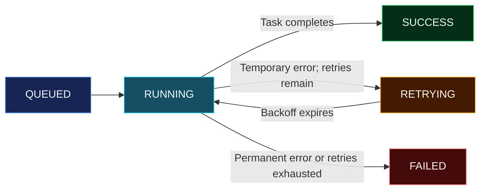

<div align="center">



# QueueWatch — A Python CLI for Job Processing, Monitoring, Retries, and AI-Assisted Failure Analysis

**Submit a job. Track its progress. Retry temporary failures. Understand what went wrong.** 

A lightweight Python CLI that runs jobs in background processes, records their status in SQLite, and optionally uses AI to explain failures.


[Quick start](#quick-start) · [Commands](#commands) · [How it works](#how-it-works) · [Development](#development)

</div>

## Background jobs, without the infrastructure overhead

QueueWatch keeps local job processing simple: a fixed set of tasks, a separate Python worker for each submitted job, and a SQLite record you can inspect from your terminal. No database server, message broker, or worker service to configure.

| Feature | What you get |
| --- | --- |
| Background execution | Submit a job and get its ID immediately. |
| Persistent status tracking | Inspect job details and recent jobs stored in SQLite. |
| Automatic retries | Retry temporary failures with exponential backoff. |
| Failure classification | Stop immediately on permanent errors such as bad input or missing files. |
| At-a-glance totals | View counts by status using SQL `GROUP BY`. |
| Optional AI explanations | Ask an LLM to explain a failed job after best-effort sanitization. |

Terminal output uses **whole-line colour coding**, with status labels for clarity:

🟢 **Green** — success &nbsp; · &nbsp; 🟡 **Yellow** — warning or retrying &nbsp; · &nbsp; 🔴 **Red** — failed

## Quick start

From the repository root, create a virtual environment and install QueueWatch.

**macOS / Linux**

```bash
python -m venv .venv
source .venv/bin/activate
pip install -e ".[dev]"
```

**Windows PowerShell**

```powershell
python -m venv .venv
.venv\Scripts\Activate.ps1
pip install -e ".[dev]"
```

Run a job that fails twice before succeeding, and wait for the final result:

```bash
queuewatch submit simulate-failure --wait
```

Then inspect your jobs:

```bash
queuewatch list
queuewatch stats
```

You can also run the CLI from the source directory with `python -m queuewatch list`, provided its dependencies are installed.

### Enable AI explanations (optional)

Copy the example configuration:

```bash
# macOS / Linux
cp .env.example .env
```

```powershell
# Windows PowerShell
Copy-Item .env.example .env
```

Add your `LLM_API_KEY` to `.env` and follow any provider settings in `.env.example`. Keep the key private and do not commit `.env` to Git.

**Every command except `explain` works without an API key.**

## Commands

| Command | Purpose | Example |
| --- | --- | --- |
| `submit` | Start an allowed task in the background | `queuewatch submit generate-report --input weekly` |
| `status` | Inspect one job | `queuewatch status <job-id>` |
| `list` | Display recent jobs in a table | `queuewatch list` |
| `stats` | Show totals for each status | `queuewatch stats` |
| `retry` | Run a failed job again | `queuewatch retry <job-id>` |
| `explain` | Request an AI explanation of a failed job | `queuewatch explain <job-id>` |

Replace `<job-id>` with the ID returned by `submit`. Add `--wait` to `submit` to wait and display the final result.

### Try the included tasks

```bash
# Process the sample CSV
queuewatch submit process-csv --file examples/sales.csv

# Generate a report
queuewatch submit generate-report --input weekly

# Temporary failure: fails twice, then succeeds
queuewatch submit simulate-failure

# Persistent temporary failure: exhausts retries and ends as FAILED
queuewatch submit simulate-failure --input always

# Permanent failure: stops after one attempt, without retrying
queuewatch submit simulate-failure --input permanent

# Watch a retry scenario through to its final result
queuewatch submit simulate-failure --wait
```

## How it works



1. **Validate and save.** `submit` checks the input and creates a `QUEUED` record in SQLite.
2. **Launch a worker.** A separate process runs `python -m queuewatch.runner <id>`, allowing the CLI to return immediately unless `--wait` is set.
3. **Execute and track.** The worker runs the task and updates the job's status in SQLite.
4. **Retry when appropriate.** Temporary errors trigger backoff; permanent errors stop execution.
5. **Explain on request.** `explain` sanitizes the error and sends one short request to the configured LLM.

### Retry behaviour

`MAX_RETRIES` defaults to **3 retries after the initial attempt**, with delays of **1s → 2s → 4s**.

| Outcome | Behaviour |
| --- | --- |
| Task succeeds | Mark the job `SUCCESS`. |
| Temporary error, retries available | Mark it `RETRYING`, wait, and try again. |
| Temporary error, retries exhausted | Mark the job `FAILED`. |
| Permanent error | Mark the job `FAILED` without retrying. |

Use `queuewatch retry <job-id>` to manually run a failed job again.

## AI-assisted failure analysis

AI explanations are **optional and advisory**. They help interpret a failure; they do not execute fixes or control retry decisions.

Before sending an error to the LLM, QueueWatch attempts to remove secrets, email addresses, and file paths. The request is made through `requests`, and LLM calls are mocked in tests.

> **Privacy:** Sanitization is best-effort. Remaining error content is sent to the configured LLM provider when you run `explain`. Do not put secrets in job inputs.

## Project structure

```text
queuewatch/
├── main.py          # Typer CLI commands
├── ui.py            # Rich colours, tables, and panels
├── config.py        # Environment and .env settings
├── database.py      # SQLite connection and table setup
├── jobs.py          # Create, read, update, and count jobs
├── tasks.py         # The three allowed tasks
├── runner.py        # Background execution and retries
└── ai_explainer.py  # Error sanitization and one LLM API call
tests/               # pytest tests; LLM calls are mocked
examples/
└── sales.csv        # Sample input
```

## Development

Requires **Python 3.9+**. Install development dependencies with `pip install -e ".[dev]"`, then run:

```bash
pytest
```

| Component | Technology |
| --- | --- |
| Command-line interface | Typer |
| Terminal presentation | Rich |
| Persistence and aggregation | SQLite / SQL |
| Background workers | Python `subprocess` |
| LLM HTTP requests | Requests |
| Tests | pytest |

## Design choices

- **SQLite keeps setup small.** Job state lives in a local database with no server to manage.
- **Subprocesses separate execution from the CLI.** Each worker runs independently, without requiring Celery or Redis. A production version could adopt those tools as its needs grow.
- **A fixed task list limits execution.** QueueWatch runs its three supported tasks; it does not execute arbitrary shell commands or user-supplied code.
- **AI stays optional.** Job execution, monitoring, and retries do not depend on an LLM.

## Current limitations

- A worker killed mid-job can leave its job marked `RUNNING`; automatic recovery is not implemented.
- There is no exactly-once execution guarantee. The included example tasks are safe to run twice.
- Error sanitization is best-effort and cannot guarantee removal of all sensitive information.
- QueueWatch is designed for a single machine.